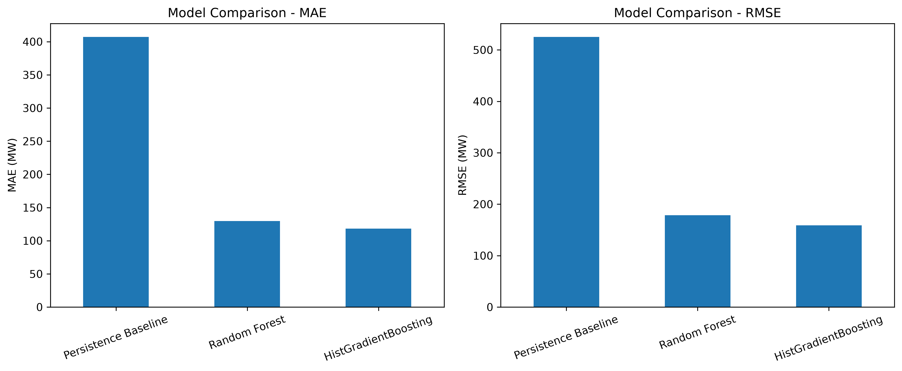
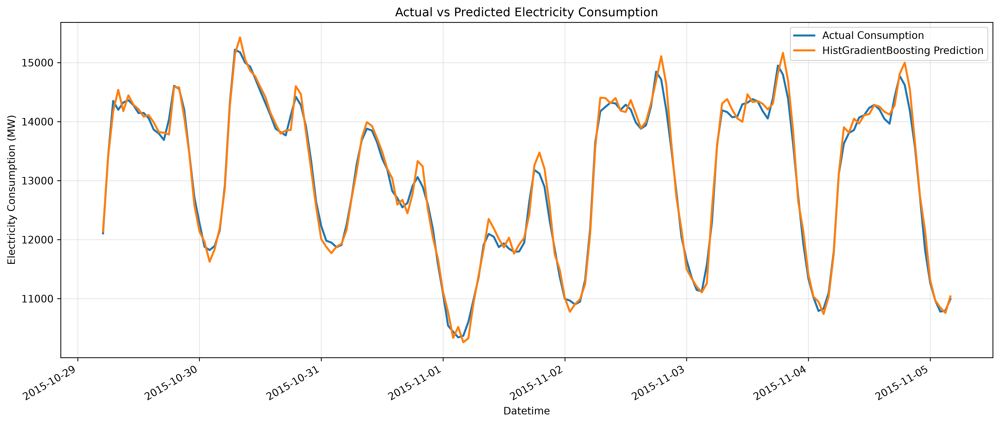
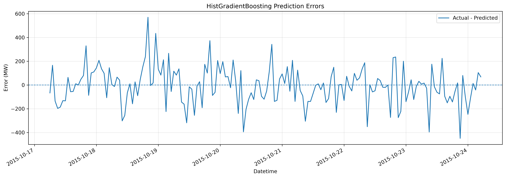

# Short-Term Energy Consumption Forecasting

## Project Overview

This project focuses on forecasting short-term electricity consumption using historical energy consumption data and machine learning models.

The main goal is to predict electricity consumption for the next hour based on previous consumption values and time-related features. Three approaches are compared: a Persistence Baseline, Random Forest, and HistGradientBoosting.

This project was developed as a student machine learning project to practice data preprocessing, feature engineering, time-based model evaluation, and prediction error analysis.

## Objectives

- Explore and prepare historical electricity consumption data.
- Create time-based features and lag variables.
- Predict electricity consumption one hour ahead.
- Compare different forecasting approaches using MAE and RMSE.
- Visualize actual and predicted consumption.
- Analyze prediction errors and sudden changes in electricity demand.

## Dataset

The project uses the **AEP Hourly Energy Consumption** dataset from Kaggle.

**Dataset source:** [Hourly Energy Consumption — Kaggle](https://www.kaggle.com/datasets/robikscube/hourly-energy-consumption)

The dataset file used in this project is `AEP_hourly.csv`.

| Property | Description |
|---|---|
| Dataset | AEP Hourly Energy Consumption |
| Timestamp column | `Datetime` |
| Target measurement | `AEP_MW` |
| Unit | Megawatts (MW) |
| Original observations | Approximately 121,273 rows |
| Time period | October 2004 – August 2018 |

The dataset contains historical electricity consumption measurements recorded over time.

Before model training, the timestamps are sorted chronologically and duplicate timestamps are removed. The last reading is retained when duplicate timestamps are found.

Some consecutive observations are separated by two hours rather than one. The project checks these intervals and uses timestamp-based lag features to avoid treating every previous row as exactly one hour earlier.

## Technologies Used

- Python
- Pandas
- NumPy
- Matplotlib
- Scikit-learn
- Git and GitHub

## Project Structure

```text
Short-Term Energy Consumption Forecasting/
├── data/
│   └── raw/
│       └── AEP_hourly.csv
├── notebooks/
│   └── 01_exploratory_data_analysis.ipynb
├── reports/
│   ├── actual_vs_predicted.png
│   ├── model_comparison.png
│   ├── model_predictions.csv
│   ├── model_results.csv
│   ├── prediction_error_analysis.csv
│   └── prediction_errors.png
├── src/
│   ├── data_loader.py
│   ├── inspect_timestamps.py
│   └── train.py
├── .gitignore
├── requirements.txt
└── README.md
```

*Note: The dataset location must match the path configured in `src/data_loader.py`. The structure above describes the main project files and generated reports.*

## Methodology

### 1. Data Preparation

The dataset is loaded and sorted by timestamp. Duplicate timestamps are removed, and the time intervals between consecutive observations are examined.

Missing values created by lag features and the forecasting target are removed before training.

In the current run, 304 rows were removed during this preparation stage, leaving **120,965 observations** for model development and evaluation.

### 2. Feature Engineering

The following features are used to predict future electricity consumption:

| Feature | Description |
|---|---|
| `AEP_MW` | Current electricity consumption |
| `Hour` | Hour of the day |
| `DayOfWeek` | Day of the week |
| `Month` | Month of the year |
| `Year` | Calendar year |
| `IsWeekend` | Indicates whether the day is a weekend |
| `Lag_1` | Consumption at the timestamp one hour earlier |
| `Lag_2` | Consumption at the timestamp two hours earlier |
| `Lag_24` | Consumption at the timestamp 24 hours earlier |
| `Lag_168` | Consumption at the timestamp 168 hours earlier |
| `Recent_Change` | Difference between current consumption and `Lag_1` |

The lag features are matched using timestamps rather than simply selecting previous rows. This is important because some intervals in the dataset are not exactly one hour long.

### 3. Forecasting Target

The target variable is named `Target`.

It represents electricity consumption at the timestamp exactly one hour after the current observation.

The task can be summarized as:

**Input:** Current consumption, historical consumption, and time-related features.

**Output:** Predicted electricity consumption one hour ahead.

### 4. Train-Test Split

The data is split chronologically rather than randomly to preserve the time order.

- Training set: 80%
- Testing set: 20%

The current run contains 96,772 training samples and 24,193 testing samples.

The test set is used to compare the models on observations that come later in time than the training observations.

## Machine Learning Models

Three forecasting approaches are evaluated.

### 1. Persistence Baseline

The baseline predicts that the next hour's consumption will be equal to the current hour's consumption.

This simple approach provides a reference point for evaluating whether machine learning improves forecasting performance.

### 2. Random Forest Regressor

Random Forest combines predictions from multiple decision trees. It can model nonlinear relationships between electricity consumption, historical values, and time-related features.

Main configuration:

- `n_estimators = 100`
- `random_state = 42`
- `n_jobs = -1`

### 3. HistGradientBoosting Regressor

HistGradientBoosting builds an ensemble of decision trees sequentially, with each stage helping improve the model's predictions.

Main configuration:

- `max_iter = 300`
- `learning_rate = 0.05`
- `max_leaf_nodes = 31`
- `random_state = 42`

## Evaluation Metrics

Two metrics are used to evaluate forecasting performance.

**Mean Absolute Error (MAE)**

MAE measures the average absolute difference between actual and predicted electricity consumption. Lower values indicate better performance.

**Root Mean Squared Error (RMSE)**

RMSE gives greater weight to larger prediction errors. Lower values indicate better performance.

Both metrics are reported in megawatts (MW).

## Results

The following results were obtained from the current execution of `src/train.py`.

| Model | MAE (MW) | RMSE (MW) |
|---|---:|---:|
| Persistence Baseline | 407.94 | 525.86 |
| Random Forest | 128.97 | 177.75 |
| **HistGradientBoosting** | **118.19** | **159.13** |

HistGradientBoosting achieved the lowest MAE and RMSE among the three approaches in this experiment.

Compared with the Persistence Baseline, its MAE was approximately 71% lower. This indicates a substantial improvement over simply using current consumption as the next-hour prediction.

These results apply to the current dataset preparation, feature set, model configurations, and chronological test split. They do not guarantee the same performance on other datasets or future periods.

## Visualizations

### 1. Model Comparison

This chart compares the MAE and RMSE of the three forecasting approaches. Lower bars indicate lower prediction errors.



### 2. Actual vs. Predicted Consumption

This chart compares actual electricity consumption with HistGradientBoosting predictions over the first seven days of the test set.

The plot helps show how closely the model follows changes in electricity demand over time.



### 3. Prediction Errors

This chart shows the difference between actual consumption and predicted consumption over the same seven-day period.

- Positive error means actual consumption was higher than predicted.
- Negative error means actual consumption was lower than predicted.
- Values close to zero indicate more accurate predictions.



## Prediction Error Analysis

The error analysis is performed on both the first seven test days and the complete test set.

| Metric | First 7 Test Days | Full Test Set |
|---|---:|---:|
| Mean Error (MW) | -33.20 | -17.04 |
| MAE (MW) | 119.19 | 118.19 |
| Maximum Absolute Error (MW) | 438.05 | 3,748.17 |

The mean error is calculated as actual consumption minus predicted consumption. A negative mean error indicates a tendency to overpredict on average.

The full test set contains a few much larger errors than those observed in the first seven days. These cases are important because MAE alone does not describe every forecasting failure.

### Sudden Changes in Consumption

The analysis also compares prediction errors during periods with large changes in actual consumption.

In the current run:

- The 95th-percentile threshold for the absolute change in consumption was 1,074 MW.
- MAE during the largest 5% of changes was 156.67 MW.
- MAE during the other changes was 116.16 MW.

This suggests that larger changes in electricity consumption are more difficult to predict in this test set.

The largest absolute prediction error occurred around December 27, 2015. The difference between actual and predicted consumption reached approximately 3,748 MW at one timestamp. This case is included for further investigation, but the error alone does not establish that the underlying data is incorrect.

The generated `prediction_error_analysis.csv` file contains actual values, predictions, errors, and absolute errors for further inspection.

## Generated Outputs

Running the training script creates the following files in the `reports/` directory:

| File | Purpose |
|---|---|
| `model_results.csv` | MAE and RMSE comparison for all models |
| `model_predictions.csv` | Actual consumption and predictions from all three models |
| `prediction_error_analysis.csv` | Detailed prediction errors for the test set |
| `model_comparison.png` | Model performance comparison chart |
| `actual_vs_predicted.png` | Actual and predicted consumption plot |
| `prediction_errors.png` | Prediction error plot |

These outputs can be used to review the results, inspect individual predictions, and include figures in a project report or presentation.

## Installation and Usage

### 1. Clone the Repository

```bash
git clone https://github.com/sainagooran/short-term-energy-consumption-forecasting.git
cd short-term-energy-consumption-forecasting
```

### 2. Create a Virtual Environment

On Windows:

```powershell
python -m venv .venv
.venv\Scripts\Activate.ps1
```

### 3. Install Dependencies

If `requirements.txt` is included in the repository:

```powershell
pip install -r requirements.txt
```

Otherwise, install the main libraries:

```powershell
pip install numpy pandas matplotlib scikit-learn
```

### 4. Prepare the Dataset

Download `AEP_hourly.csv` from the Kaggle dataset linked above and place it in the location expected by `src/data_loader.py`.

### 5. Run the Project

From the project root directory, execute:

```powershell
python src\train.py
```

After execution, the model results, visualizations, and prediction analysis files will be saved in the `reports/` directory.

## Limitations

- Electricity consumption can change suddenly, making some observations difficult to forecast.
- The dataset contains some two-hour gaps between consecutive timestamps.
- The model uses historical consumption and calendar features but does not include additional information such as weather, holidays, or electricity prices.
- The reported performance comes from one chronological train-test split.
- Model performance may change across different time periods and with different feature configurations.

## Future Improvements

Possible extensions include:

- Adding weather and holiday information.
- Testing additional lag features and rolling averages.
- Comparing more forecasting algorithms.
- Evaluating performance across multiple chronological test periods.
- Investigating unusually large prediction errors.
- Building a simple interface to display future consumption predictions.

## Conclusion

This project demonstrates a basic machine learning workflow for short-term electricity consumption forecasting, from data preparation and feature engineering to model evaluation and error analysis.

Among the three approaches tested, HistGradientBoosting achieved the best results, with an MAE of 118.19 MW and an RMSE of 159.13 MW.

The results show that machine learning models can improve on a simple persistence baseline for this dataset. At the same time, the error analysis highlights the challenges of predicting sudden changes in electricity consumption.

The project provides a foundation for further experiments with time-series features, additional data sources, and more advanced forecasting methods.
